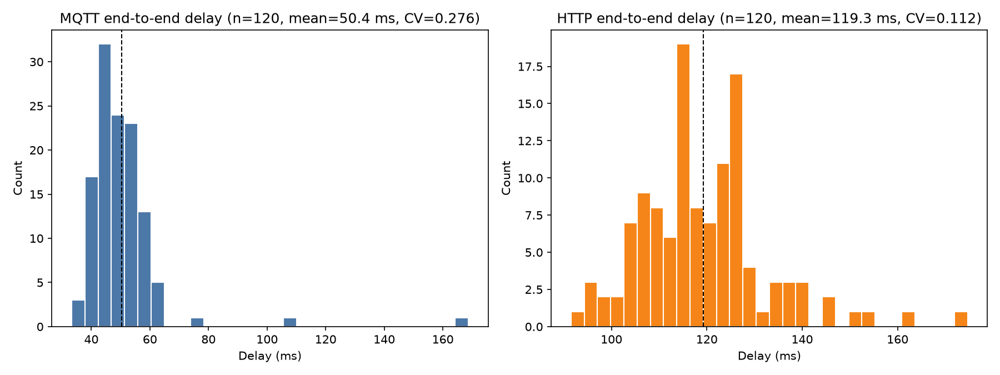

# IoT HW8：HTTP vs MQTT 端到端延遲

用 `Dummy_Device` 量 IoTtalk 的端到端延遲。同一支程式同時當 Sensor 和 Control，送出和收到都在同一台電腦，時間天生同步。

```
Dummy_Sensor (t1 = perf_counter())
   │ MQTT publish 或 HTTP push
   ▼
IoTtalk (class.iottalk.tw) ── Join 1 ──▶ Dummy_Control (t2 = perf_counter())
                                           latency = t2 − t1
```

## 檔案

| 檔案 | 用途 |
|---|---|
| `Dummy_Device_IoTtalk_v1_py/` | submodule，IoTtalk 官方 `DAI.py` / `DAN.py` / `csmapi.py` |
| `SA_latency.py` | `Dummy_Sensor` 回傳 `perf_counter()`，`Dummy_Control` 算延遲並寫進 CSV。環境變數 `PROTOCOL=mqtt/http` 切換協定 |
| `analyze.py` | 讀兩份 CSV，算平均、標準差、CV，畫直方圖 |
| `latency_mqtt.csv` / `latency_http.csv` | 實測資料，每列：序號、t1、t2、延遲（秒） |
| `latency_histogram.png` | 兩種協定的延遲分布 |

## 1. IoTtalk GUI 設定（https://classgui.iottalk.tw）

1. Project：`315834011_HW8`
2. Model：`Dummy_Device`，勾 `Dummy_Sensor` 和 `Dummy_Control`（畫面上會出現左右兩個方塊）
3. Join 1：`Dummy_Sensor` → `Dummy_Control`，Function 都用預設（disabled / x1），數值原樣傳遞
4. 兩個方塊都綁到同一個裝置（`device_id = 315834011_HW8`）

## 2. 執行

```bash
cd iot/hw8-latency
PROTOCOL=mqtt PYTHONPATH=. uv run python Dummy_Device_IoTtalk_v1_py/DAI.py SA_latency
PROTOCOL=http PYTHONPATH=. uv run python Dummy_Device_IoTtalk_v1_py/DAI.py SA_latency
uv run python analyze.py
```

每次收滿 120 筆（`SAMPLES` 可調）就自動結束。兩次執行用同一個 `device_id`，GUI 綁定不用重做。

## 3. 結果（2026-11-19，MacBook 用 Wi-Fi 連台灣大哥大手機熱點）

| 協定 | 樣本數 | 平均延遲 | 標準差 | CV | 中位數 |
|---|---|---|---|---|---|
| MQTT | 120 | 50.4 ms | 13.9 ms | 0.276 | 48.5 ms |
| HTTP | 120 | 119.3 ms | 13.4 ms | 0.112 | 117.6 ms |



- **MQTT 平均快約 2.4 倍**：連線一直開著，送出後由 broker 主動推給訂閱者，只走一趟 publish 和一趟推送
- **HTTP 慢**：`DAI.py` 每輪先 `DAN.push` 一個 HTTP 請求，再 `DAN.pull` 一個 HTTP 請求，延遲包含兩次完整的請求往返
- **MQTT 的 CV 反而較高**：大部分樣本集中在 40–60 ms，但有 3 筆 75–170 ms 的離群值拉高了標準差。CV 是相對值，MQTT 平均小，同樣幾十毫秒的抖動換算成 CV 就比較大
- **HTTP 的輪詢風險**：如果 server 還沒處理完，同一輪的 pull 會拿不到新值，要等下一輪（`exec_interval = 1` 秒）。這次正式量測沒有發生；測試時有一次出現 925 ms 的樣本就是這個原因

## 設計說明

- **時間同步**：`perf_counter()` 是單調時鐘，送出和收到在同一個 process，相減即為延遲，不需要 NTP
- **過濾舊資料**：`sent` 集合記錄本次送出的 t1，收到不在集合裡的值（上次執行殘留在 server 的資料）就跳過
- **切換 HTTP**：依作業說明把 `MQTT_broker` 設為 `None`，`DAI.py` 就改走 `DAN.push` / `DAN.pull`
- **submodule 版本**：用官方 repo 最新版 `1658b1d`，比作業連結的 `de991b3` 新，`MQTT_broker = None` 切換 HTTP 的行為相同
